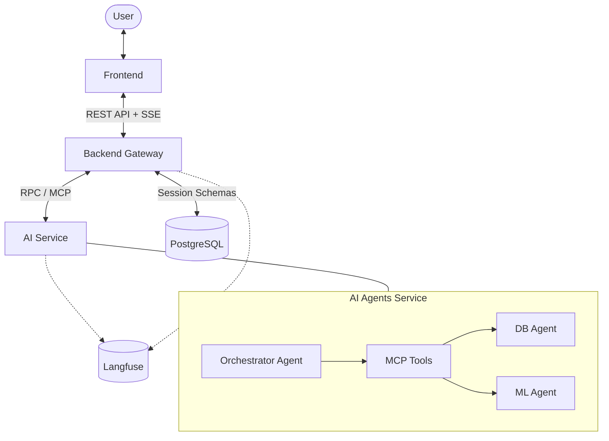

# Autonomous Multi-Agent Analytics Platform

[](https://github.com/langchain-ai/langgraph)
[](https://www.langchain.com/)
[](https://langfuse.com/)
[](https://www.python.org/)
[](https://fastapi.tiangolo.com/)
[](https://www.postgresql.org/)
[](https://www.docker.com/)
[](https://react.dev/)
[](https://www.typescriptlang.org/)

An autonomous multi-agent platform for natural language analytics over relational databases, SQL query generation, automated statistical modeling, interactive visualizations, and sandboxed dataset ingestion.

## 1. System Architecture

The platform uses a distributed, modular architecture where agents are coordinated via **LangGraph**, and inter-agent tool execution is standardized over the **Model Context Protocol (MCP)**:



## 2. Module Directory

Each subsystem includes dedicated documentation detailing its state graph, prompt policies, and tool specifications:

| Module | Scope & Responsibility | Documentation |
| :--- | :--- | :---: |
| **`agents/orchestrator`** | Central supervisor, intent routing, direct algorithmic reasoning, multi-agent synthesis | [README](agents/orchestrator/README.md) |
| **`agents/db_agent`** | Dynamic schema reflection, SQL query generation, table mutations, transactional rollbacks, file ingestion | [README](agents/db_agent/README.md) |
| **`agents/ml_agent`** | Statistical analysis, clustering, sandboxed Python code execution, interactive visualizations | [README](agents/ml_agent/README.md) |
| **`backend`** | FastAPI REST gateway, SSE streaming, multi-tenant session schemas (`session_<uuid>`), artifact management | [README](backend/README.md) |
| **`frontend`** | React 19 + TypeScript + Vite studio with split-view workspace (Data Table, Plotly Charts, Code Inspector) | [README](frontend/README.md) |
| **`shared`** | Unified LLM provider factory (Gemini), Langfuse tracing wrappers, domain metadata schemas, connection pool | [README](shared/README.md) |
| **`tests`** | Automated 6-scenario evaluation suite (Onboarding, SQL, ML, Mutations, Robustness, Ingestion) with Langfuse scoring | [README](tests/README.md) |

## 3. Quickstart (Docker Compose)

#### Step 1. Clone & Configure Environment
```bash
git clone https://github.com/your-username/multi-agent-system.git
cd multi-agent-system
cp .env.example .env
```

Set your Gemini API key in `.env`:
```env
LLM_PROVIDER=gemini
LLM_MODEL=gemini-flash-lite-latest
LLM_API_KEY=...
```

#### Step 2. Build and Start Services
```bash
docker compose up --build -d
```

#### Step 3. Access Endpoints
* **Web Studio**: [http://localhost:8080](http://localhost:8080)
* **Backend API Docs (Swagger)**: [http://localhost:8000/docs](http://localhost:8000/docs)
* **Langfuse Tracing Dashboard**: [http://localhost:3000](http://localhost:3000)

## 4. Automated Evaluation & Testing

Run the end-to-end evaluation suite across all benchmark scenarios:

#### Step 1. Run Complete Evaluation Suite
```bash
uv run pytest tests/eval/test_eval_suite.py -v
```

#### Step 2. Run Individual Scenario
```bash
uv run pytest tests/eval/test_eval_suite.py -k "sql_analytics" -v -s
```

Detailed scenario definitions and scoring policies are available in [tests/README.md](tests/README.md).
