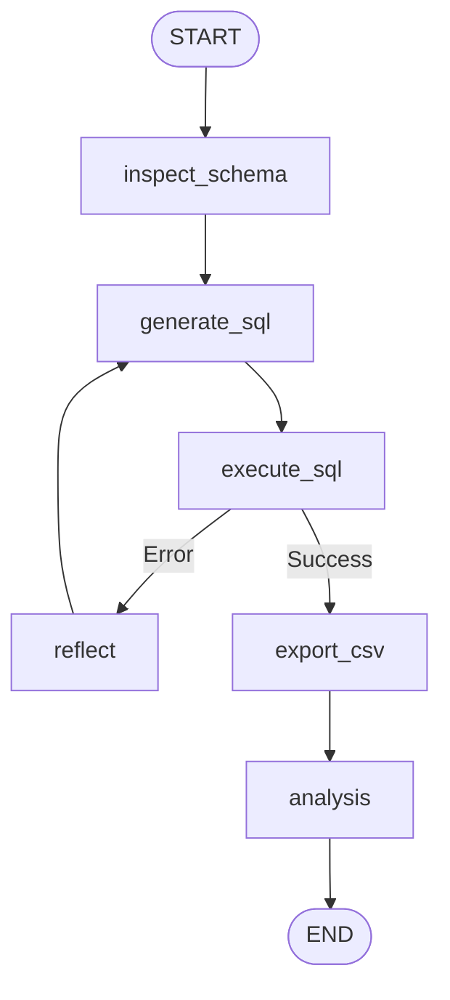

# Database Agent (DB Agent)

A specialized database analysis agent for dynamic schema reflection, SQL query generation, table modifications, tabular file ingestion, and rollback operations. Exposes tools via the **Model Context Protocol (MCP)**.

## 1. Architecture & Execution Graph

The core workflow is defined in [`agent.py`](agent.py):



## 2. Key Capabilities

| Feature | Description | Implementation |
| :--- | :--- | :--- |
| **Dynamic Schema Reflection** | Introspects live database schemas (tables, columns, types, primary keys, and foreign keys) via SQLAlchemy Reflection | [`db/inspector.py`](db/inspector.py) |
| **SQL Query Generation** | Generates and executes analytical PostgreSQL queries from natural language against the active schema | [`prompts/sql_generation.j2`](prompts/sql_generation.j2) |
| **Table Modifications** | Executes `INSERT`, `UPDATE`, and `DELETE` operations with change tracking | [`tools/modify_table.py`](tools/modify_table.py) |
| **Transactional Rollbacks** | Restores previous states step-by-step using stored pre-mutation snapshots | [`tools/rollback.py`](tools/rollback.py) |
| **Tabular File Ingestion** | Ingests uploaded CSV and XLSX files into dedicated PostgreSQL tables within the active session schema | [`tools/ingest_file.py`](tools/ingest_file.py) |
| **MCP Integration** | Standalone MCP server exposing all tools via STDIO / JSON-RPC protocol | [`mcp_server.py`](mcp_server.py) |

## 3. Directory Structure

```
agents/db_agent/
├── db/              # Database interaction layer
│   ├── connection.py# SQLAlchemy connection pool setup
│   ├── inspector.py # Schema reflection, PK/FK resolution, and schema_summary generation
│   └── replica.py   # Isolated session schema provisioning (session_<uuid>)
├── prompts/         # Jinja2 prompt templates
│   ├── analysis.j2      # Analytical findings and data interpretation prompt
│   ├── modify_table.j2  # Safe data mutation generation (INSERT/UPDATE/DELETE)
│   └── sql_generation.j2# Read query generation and dynamic schema mapping
├── tools/           # Agent execution tools
│   ├── ingest_file.py   # CSV/XLSX file ingestion tool
│   ├── modify_table.py  # Safe mutation tool with rollback snapshot capture
│   ├── rollback.py      # Mutation rollback tool
│   ├── sql_to_csv.py    # Raw SQL execution and CSV artifact generator
│   └── registry.py      # Tool registration interface
├── agent.py         # DBAgent class and execution workflow
├── mcp_server.py    # Model Context Protocol server entry point
└── config.py        # PostgreSQL credentials and LLM settings
```

## 4. Registered MCP Tools

When operating as an MCP service, the DB Agent provides:

* `query_and_analyze_database(user_input, session_id)`: End-to-end analytical query generation, execution, CSV export, and interpretation.
* `modify_database_table(user_input, session_id)`: Safe transactional modification with automatic state capture for rollbacks.
* `rollback_database_change(session_id, steps_back)`: Reverts recent table mutations.
* `get_database_schema(session_id)`: Returns the live schema summary of the active session.

## 5. Configuration & Environment

Environment variables configured via `.env` or container settings:

* `DB_HOST`: PostgreSQL hostname (`localhost` or `postgres`).
* `DB_PORT`: PostgreSQL port (`5432`).
* `DB_NAME`: Database catalog name (`app_db`).
* `DB_USER` / `DB_PASSWORD`: Database authentication credentials.
* `LLM_PROVIDER` / `LLM_MODEL`: Provider and model name.
