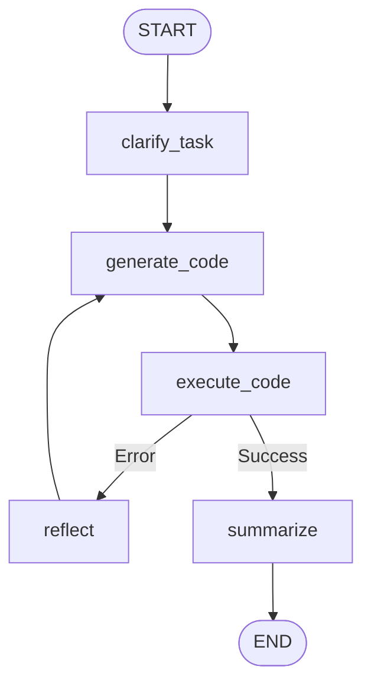

# Machine Learning Agent (ML Agent)

A specialized analytics agent for automated statistical analysis, clustering, predictive modeling, and interactive visualizations via sandboxed Python code execution.

## 1. Architecture & Execution Graph

The execution workflow is defined in [`agent.py`](agent.py):



## 2. Key Capabilities

| Feature | Description | Implementation |
| :--- | :--- | :--- |
| **Python Code Generation** | Generates executable data processing, statistical modeling, and visualization scripts | [`prompts/code_generation.j2`](prompts/code_generation.j2) |
| **Sandboxed Execution** | Runs generated code in an isolated subprocess with strict timeouts, capturing execution outputs and artifacts | [`runner.py`](runner.py) |
| **Interactive Visualizations** | Generates interactive chart figures from analytical results | [`prompts/chart_guidelines.j2`](prompts/chart_guidelines.j2) |
| **Self-Correction & Reflection** | Analyzes runtime exceptions and tracebacks to automatically repair generated scripts | `reflect` node |
| **MCP Integration** | Standalone MCP server exposing ML analysis tools over standard protocols | [`mcp_server.py`](mcp_server.py) |

## 3. Directory Structure

```
agents/ml_agent/
├── prompts/                # Jinja2 prompt templates
│   ├── chart_guidelines.j2 # Chart rendering guidelines
│   ├── code_generation.j2  # Data processing and visualization code generator
│   ├── summary.j2          # Statistical insights and narrative summary generator
│   └── task_clarity.j2     # Task feasibility and data availability validator
├── utils/                  # Code block extractors and JSON sanitizers
├── agent.py                # MLAgent class and execution workflow
├── runner.py               # Isolated Python code execution engine
├── mcp_server.py           # Model Context Protocol server entry point
└── config.py               # Execution timeouts and sandbox environment settings
```

## 4. Configuration & Environment

Environment variables configured via `.env` or container settings:

* `LLM_PROVIDER`: Provider name (`gemini`).
* `LLM_MODEL`: Active model name (`gemini-flash-lite-latest`).
* `LLM_API_KEY`: API authentication key.
* `EXECUTION_TIMEOUT`: Sandbox subprocess execution timeout in seconds.
