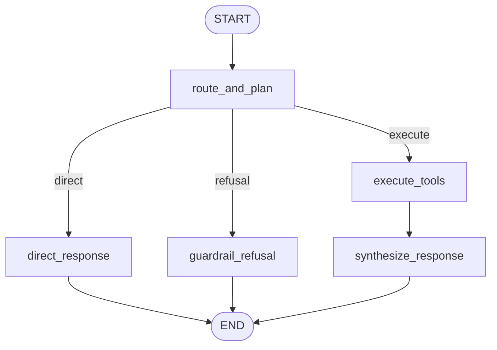

# Orchestrator Agent

A central supervisor agent that classifies user intent, routes tasks to specialized domain agents via the **Model Context Protocol (MCP)**, performs direct algorithmic reasoning, and synthesizes multi-agent responses.

## 1. Architecture & Execution Graph

The execution workflow is defined in [`agent.py`](agent.py):



## 2. Key Capabilities

| Feature | Description | Implementation |
| :--- | :--- | :--- |
| **Dynamic Intent Planning** | Formulates a structured execution plan (`ExecutionPlan`) with sequential tool steps based on user intent | [`prompts/routing.j2`](prompts/routing.j2) |
| **Dataset Agnosticism** | Operates dynamically over arbitrary schemas; routing relies purely on semantic intent and active session metadata | `active_metadata` in state |
| **Contextual Mutation Forwarding** | Correctly forwards database modification requests (`DELETE`, `UPDATE`, `INSERT`, `ROLLBACK`) directly to the DB Agent | Semantic routing policy |
| **Artifact Synthesis** | Consolidates textual insights, tabular results, and Plotly chart JSON into a unified, structured response | [`prompts/synthesis.j2`](prompts/synthesis.j2) |
| **Observability** | Emits distributed trace spans and evaluation metadata to Langfuse for each planning and synthesis step | `shared.observability` |

## 3. Directory Structure

```
agents/orchestrator/
├── client/          # Inter-agent communication client (MCP Client)
├── models/          # State schema and routing Pydantic definitions
├── prompts/         # Jinja2 prompt templates
│   ├── direct.j2    # Direct answers, algorithmic comparison, and schema explanations
│   ├── routing.j2   # Intent classification and tool routing policy
│   └── synthesis.j2 # Multi-artifact response synthesis
├── utils/           # Tool description and formatting helpers
├── agent.py         # OrchestratorAgent class and execution workflow
└── config.py        # Environment configuration and service endpoints
```

## 4. Routing Policies & Tool Planning

The orchestrator classifies incoming queries and plans execution:

* `direct`: Algorithmic explanations, greetings, and conceptual responses handled directly without tool execution.
* `execute`: Dynamic multi-step tool execution via MCP (`query_and_analyze_database`, `run_ml_analysis`, `modify_database_table`, `rollback_database_change`).
* `refusal`: Polite out-of-scope refusal for requests violating system guardrails.

## 5. Configuration & Environment

Environment variables configured via `.env` or container settings:

* `LLM_PROVIDER`: Provider name (`gemini`).
* `LLM_MODEL`: Active model name (`gemini-flash-lite-latest`).
* `LLM_API_KEY`: API authentication key.
* `DB_AGENT_URL` / `ML_AGENT_URL`: Service URLs for network-based agent execution.
