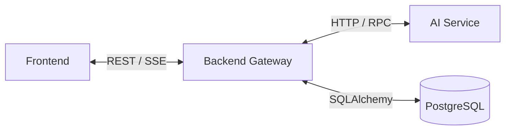

# Backend Gateway Service

A high-performance gateway service built with **FastAPI** providing REST APIs, Server-Sent Events (SSE) streaming, isolated multi-tenant session management in PostgreSQL, tabular dataset ingestion, and routing to the AI agent service.

## 1. Architecture & Service Context



## 2. Key Capabilities

| Feature | Description | Implementation |
| :--- | :--- | :--- |
| **Real-Time SSE Streaming** | `POST /api/query/stream` streams live status events (`Routing intent...`, `Generating SQL...`) and the final payload | [`routes/query.py`](routes/query.py) |
| **Session Isolation (Multi-Tenancy)** | Provisions a dedicated schema per session (`session_<uuid>`) to isolate table modifications from the base catalog | [`database.py`](database.py) |
| **Session Lifecycle Management** | Complete CRUD operations for sessions: listing, switching, inline renaming, and cascading schema deletion | [`routes/artifacts.py`](routes/artifacts.py) |
| **Dataset Ingestion** | `POST /api/upload` endpoint for multipart CSV/XLSX uploads, registering metadata and creating tables | [`routes/upload.py`](routes/upload.py) |
| **Dataset Inspection** | Endpoints for previewing paginated table rows and schemas for active datasets | [`routes/artifacts.py`](routes/artifacts.py) |

## 3. Directory Structure

```
backend/
├── routes/          # API route definitions
│   ├── artifacts.py # Session management, dataset inspection, and table previews
│   ├── query.py     # Synchronous and streaming query handlers
│   └── upload.py    # Multipart file ingestion handlers
├── app.py           # FastAPI application factory, middleware, and CORS setup
├── database.py      # Session schema provisioning and database connections
├── schemas.py       # Pydantic request and response schemas
└── __main__.py      # Uvicorn entry point
```

## 4. API Endpoints Specification

### 4.1 Queries & Streaming
* `POST /api/query`: Synchronous query execution returning the complete structured response.
* `POST /api/query/stream`: Server-Sent Events (SSE) stream delivering progress updates and final turn artifacts.

### 4.2 Sessions Lifecycle
* `GET /api/sessions`: Returns all saved chat sessions ordered by creation date.
* `POST /api/sessions`: Creates a new session and provisions an isolated PostgreSQL schema.
* `PATCH /api/sessions/{id}`: Renames a session title.
* `DELETE /api/sessions/{id}`: Deletes a session and drops its isolated PostgreSQL schema.

### 4.3 Datasets & Ingestion
* `POST /api/upload`: Uploads a file (`multipart/form-data`) and creates a table in the session schema.
* `GET /api/datasets/{id}`: Fetches dataset metadata and preview rows.
* `GET /api/tables/{name}`: Fetches schema and paginated rows for a specific session table.
