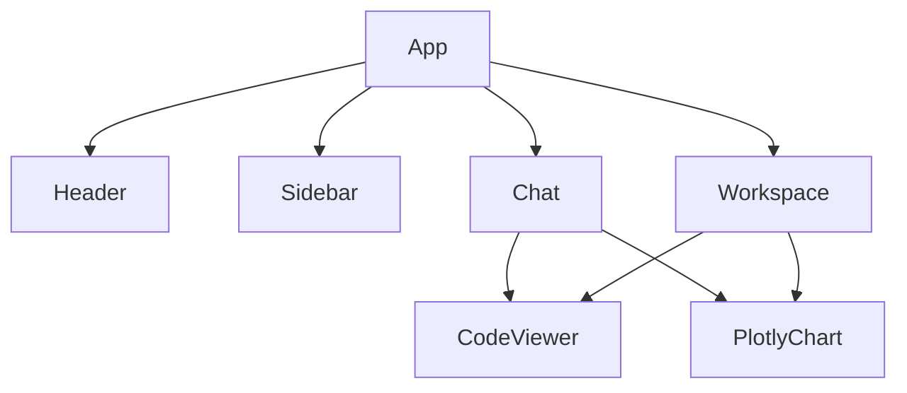

# Multi-Agent Studio - Frontend

An analytical web interface built with **React 19**, **TypeScript**, and **Vite**, featuring split-view orchestration, interactive data tables, Plotly visualizations, and code inspection.

## 1. Architecture & Core Libraries

* **Framework**: React 19 + TypeScript + Vite.
* **Core Libraries**:
  * `lucide-react`: Lightweight iconography.
  * `plotly.js-dist-min`: Interactive 2D and 3D figure rendering.
  * `marked`: Markdown rendering for assistant messages.
  * `prismjs`: Syntax highlighting for Python and SQL.

## 2. Component Hierarchy



## 3. Directory Structure

```
frontend/
├── src/
│   ├── components/
│   │   ├── Header.tsx         # Brand header, status indicator, and sidebar toggle
│   │   ├── Sidebar.tsx        # Session drawer with inline rename and delete confirmation
│   │   ├── Chat.tsx           # Chat stream, suggestions, and query input bar
│   │   ├── Workspace.tsx      # Split-view tabbed workspace (Table, Chart, Code)
│   │   ├── PlotlyChart.tsx    # Responsive Plotly figure widget
│   │   ├── CodeViewer.tsx     # Syntax-highlighted code viewer widget
│   │   └── FileAttachModal.tsx# File attachment and dataset upload modal
│   ├── services/
│   │   └── api.ts             # Typed REST and SSE API client
│   ├── utils/
│   │   ├── formatters.ts      # Title truncation and file size formatting helpers
│   │   └── scrollAutoHide.ts  # Scrollbar gutter management utilities
│   ├── types.ts               # TypeScript interfaces for sessions, turns, and artifacts
│   ├── index.css              # Application layout and UI styles
│   ├── App.tsx                # Main application state orchestrator
│   └── main.tsx               # React DOM entry point
├── Dockerfile                 # Containerized Vite production server
└── vite.config.ts             # Vite configuration with proxy to backend :8000
```

## 4. Workspace Capabilities

* **Data Table Tab**: Tabular preview for SQL query results and uploaded files, client-side pagination, real-time search, and one-click CSV export.
* **Visualization Tab**: Renders interactive Plotly figures with zoom, pan, and hover tooltips, with clipboard snapshot copying.
* **Code Tab**: Full script viewer for generated SQL queries and Python routines with Prism syntax highlighting and one-click copying.
* **Turn Navigation**: Seamless navigation between conversation steps (`Turn #1`, `Turn #2`...) with instant restoration of historical workspace artifacts.
