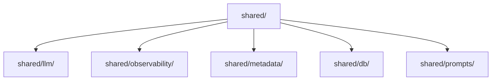

# Shared Core Library

The foundational package containing common LLM provider integrations, distributed Langfuse observability wrappers, domain artifact schemas, database utilities, and prompt templates shared across all agents and backend services.

## 1. Package Components



## 2. Key Capabilities & Modules

| Module | Purpose | Key Exports |
| :--- | :--- | :--- |
| **`shared/llm/`** | Unified interface for invoking LLM models | `LLMFactory`, `BaseLLM`, `GeminiLLM` |
| **`shared/observability/`** | Distributed tracing and span management with Langfuse | `create_trace`, `trace_span`, `flush_langfuse` |
| **`shared/metadata/`** | Structured data types for turns, tables, and charts | `DatasetData`, `TurnArtifacts`, `TableData`, `build_domain_metadata` |
| **`shared/prompts/`** | Centralized Jinja2 template loading and rendering | `PromptLoader` |
| **`shared/db/`** | Engine creation and session schema isolation | `create_db_engine`, `ensure_session_replica` |

## 3. Directory Structure

```
shared/
├── db/              # Database connection and schema replication helpers
├── llm/             # LLM provider abstractions (BaseLLM, GeminiLLM, Factory)
├── metadata/        # Structured schemas for datasets, tables, and turn artifacts
├── observability/   # Langfuse tracing, span context, and flush utilities
├── prompts/         # Centralized Jinja2 prompt loader engine
└── tools/           # Shared base tool definitions
```

## 4. Usage Examples

#### Step 1. Instantiating an LLM Provider via Factory
```python
from shared.llm import LLMFactory

model = LLMFactory.create(
    provider="gemini",
    model_name="gemini-flash-lite-latest",
    api_key="...",
    temperature=0.0
)
response = model.invoke("Analyze the dataset structure.")
```

#### Step 2. Wrapping an Operation in a Langfuse Trace Span
```python
from shared.observability import trace_span

with trace_span("agent.process_step", inputs={"query": "test"}) as span:
    # Execution logic
    if span:
        span.update(output={"status": "success"})
```
